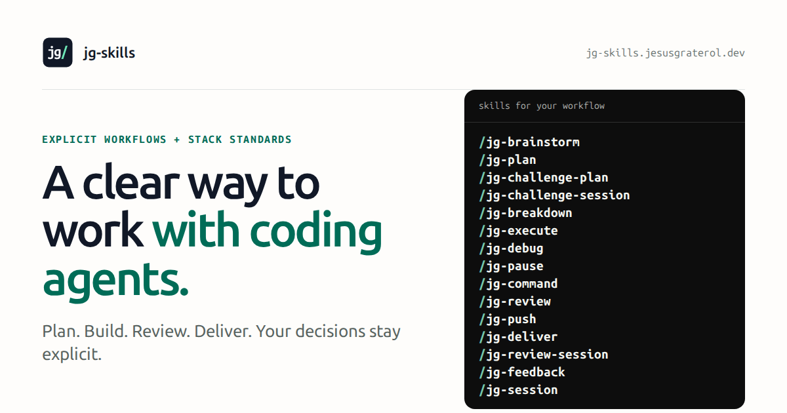

# jg-skills

[](https://jg-skills.jesusgraterol.dev)

Explicit workflows for planning, implementing, reviewing and delivering changes with coding agents. Explicit skills define what they may change and defer general engineering standards to the coding instructions of the repository you use them in. Implicit skills carry the stack-specific standards, such as PostgreSQL or React, and load on their own when a task touches their stack.

Browse the skills, their full instructions, and an example session at [jg-skills.jesusgraterol.dev](https://jg-skills.jesusgraterol.dev).

## Install

Run this from your repository's root:

```bash
npx skills add jesusgraterol/jg-skills --skill "*" -y
```

The command uses the [skills CLI](https://github.com/vercel-labs/skills) through `npx`, so it needs Node.js. It installs the skills into the project for the coding agents you use there, so you can commit them and share the same workflow with your team.

## Project blueprint

| Task                                                                | Documentation                                                                                                                  |
| ------------------------------------------------------------------- | ------------------------------------------------------------------------------------------------------------------------------ |
| Choose a skill, invoke a workflow or update/remove installations    | [Skill catalogue](docs/skill-catalog.md), with every explicit workflow, implicit trigger, planning runtime and an example run. |
| Add, write, maintain, rename or remove a skill                      | [Skill guidelines](docs/skill-guidelines.md), covering shared sections, version reviews, metadata and verification.            |
| Find source owners, develop the website or check generated guidance | [Development](docs/development.md), with setup, checks, deployment and the reviewed-version JSON owner.                        |
| Choose an icon or inspect artwork provenance                        | [Skill icons](docs/skill-icons.md) and [asset attribution](docs/asset-attribution.md).                                         |
| Integrate or activate a change                                      | [Delivery](docs/delivery.md), including the separate development/main stops and live-installation preconditions.               |

`skills/` holds the installed artifacts; `configs/` holds reviewed source facts; `website/` builds the catalogue and documentation site. `docs/` holds durable guides. Skill sources are the instruction authority; the website presents those same files.

## Credits

A few ideas in these skills are adapted from other open-source skill collections and rewritten in our own words:

- [superpowers](https://github.com/obra/superpowers) by Jesse Vincent (MIT): fixing only blocking review findings, checking acceptance criteria before calling work done, a three-attempt stop rule, reporting the decisions an agent made, and a plan self-check.
- [agent-skills](https://github.com/addyosmani/agent-skills) by Addy Osmani (MIT): labeling findings by severity, and listing what was noticed but left alone.
- [pstack](https://github.com/poteto/plugins/tree/main/pstack) by Lauren Tan (MIT): proving a change works on the real path, never weakening a check to get it through, and checking for the same pattern after a fix.
- [skills](https://github.com/mattpocock/skills) by Matt Pocock (MIT): milestones that fit one context window, batched questions with recommended answers, and the debugging loop behind `jg-debug`.

## License

[MIT](LICENSE)
