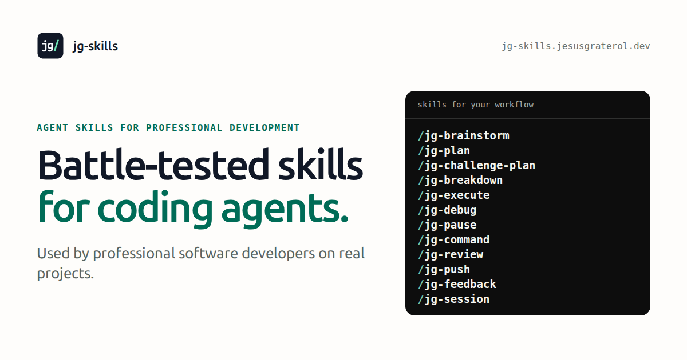

# jg-skills

[](https://jg-skills.jesusgraterol.dev)

Solid, battle-tested Agent Skills for planning, reviewing, and shipping changes with coding agents, used by professional software developers in their daily work. Explicit skills define what they may change and defer general engineering standards to the coding instructions of the repository you use them in. Implicit skills carry the stack-specific standards, such as PostgreSQL or React, and load on their own when a task touches their stack.

Browse the skills, their full instructions, and an example session at [jg-skills.jesusgraterol.dev](https://jg-skills.jesusgraterol.dev).

## Install

Run this from your repository's root:

```bash
npx skills add jesusgraterol/jg-skills --skill "*" -y
```

The command uses the [skills CLI](https://github.com/vercel-labs/skills) through `npx`, so it needs Node.js. It installs the skills into the project for the coding agents you use there, so you can commit them and share the same workflow with your team.

## Use

Discuss a change with your coding agent, then invoke a skill by name, followed by any text it should take into account:

```text
/jg-plan
```

In Codex, type `$jg-plan` instead.

The collection has two kinds of skill. Explicit skills run only when you invoke them by name: each sets `disable-model-invocation: true` in its frontmatter and ships an `agents/openai.yaml` policy that disables implicit invocation. Explicit-only loading is verified with Claude Code and Codex.

Implicit skills load on their own when a task touches their stack, such as a migration for `jg-postgres` or a component for `jg-react`. They omit that flag, and their `agents/openai.yaml` allows implicit invocation. You can still invoke one by name to load it before a task. Implicit loading is verified with Claude Code and Codex.

## Update and remove

Run these from your repository's root:

```bash
npx skills update -p jg-brainstorm jg-plan jg-challenge-plan jg-challenge-session jg-breakdown jg-execute jg-debug jg-pause jg-command jg-review jg-push jg-review-session jg-feedback jg-session jg-frontend jg-react jg-pwa jg-seo jg-svg jg-graphics jg-nestjs jg-postgres jg-redis jg-node jg-packages jg-npm-package jg-monorepo jg-bash jg-docker jg-ci jg-zod jg-testing
```

```bash
npx skills remove jg-brainstorm jg-plan jg-challenge-plan jg-challenge-session jg-breakdown jg-execute jg-debug jg-pause jg-command jg-review jg-push jg-review-session jg-feedback jg-session jg-frontend jg-react jg-pwa jg-seo jg-svg jg-graphics jg-nestjs jg-postgres jg-redis jg-node jg-packages jg-npm-package jg-monorepo jg-bash jg-docker jg-ci jg-zod jg-testing
```

Both commands name the skills, so other skills in the project are left alone. Update refreshes only the skills you already have, so rerun the install command to add skills released since you installed.

## Skills

### Explicit skills

| Skill                  | What it does                                                                                             | What it may change                                                                                                                                                              |
| ---------------------- | -------------------------------------------------------------------------------------------------------- | ------------------------------------------------------------------------------------------------------------------------------------------------------------------------------- |
| `jg-brainstorm`        | Thinks an idea through with you and recommends a direction before planning.                              | Nothing.                                                                                                                                                                        |
| `jg-plan`              | Settles your decisions with you, then creates or revises an implementation-ready plan.                   | Creates/revises plan.md with guarded tooling while retaining milestone identities and progress.                                                                                 |
| `jg-challenge-plan`    | Challenges a plan before approval and surfaces material risks, gaps, and decisions.                      | Nothing.                                                                                                                                                                        |
| `jg-challenge-session` | Reads another Claude Code or Codex session and challenges its direction, plan, and milestones.           | Nothing.                                                                                                                                                                        |
| `jg-breakdown`         | Splits a plan into ordered, reviewable milestones when it has real implementation boundaries.            | Writes or removes `milestones.md` next to the plan.                                                                                                                             |
| `jg-execute`           | Builds an agreed task, a plan, or its milestones; supervised by default, or `auto`.                      | Code and guarded milestone/aggregate plan progress. In autonomous mode it also commits and pushes each milestone's files and the fixes from its final review of the whole plan. |
| `jg-debug`             | Reproduces a bug, finds its cause, and fixes it with a regression test that fails first.                 | Code, a regression test, and temporary logging it removes. Never commits.                                                                                                       |
| `jg-pause`             | Stops at the nearest safe point, reports where things stand, and waits until you continue.               | Nothing.                                                                                                                                                                        |
| `jg-command`           | Turns a task into a few checked shell commands for your machine and explains each one.                   | Nothing until you pick; then runs that command. Irreversible ones ask again; `sudo` ones are printed.                                                                           |
| `jg-review`            | Reviews the task's changes against its plan, a finished plan as a whole, or the branch against a target. | No files. With a target branch, it may refresh that branch's remote-tracking ref.                                                                                               |
| `jg-push`              | Commits the current task's files, signed when signing is set up, and pushes the branch.                  | Stages and commits the task's files (or every change without a task) and pushes the current branch.                                                                             |
| `jg-review-session`    | Reviews what another session built against its plan, milestones, and your decisions.                     | Nothing.                                                                                                                                                                        |
| `jg-feedback`          | Assesses feedback independently and recommends what to adopt, reject, or adjust.                         | Nothing.                                                                                                                                                                        |
| `jg-session`           | Finds a named Codex or Claude Code session and answers questions about it.                               | Nothing.                                                                                                                                                                        |

### Implicit skills

| Skill         | Loads when a task touches                                                                                       | Written for                                                                                          |
| ------------- | --------------------------------------------------------------------------------------------------------------- | ---------------------------------------------------------------------------------------------------- |
| `jg-frontend` | UI, styling, forms, accessibility, mobile behavior, motion, single-page-app delivery, or frontend tests.        | Tailwind CSS 4.3, browser behavior as of October 2026                                                |
| `jg-react`    | React components, hooks, state, data loading, routing, server rendering, client data caching, or React tests.   | React 19.2, React Router 7                                                                           |
| `jg-pwa`      | Web app manifests, install prompts, service workers, offline caching, or web push.                              | The web platform as of October 2026, Playwright 1.64, `jg-sw` 1.4 where installed                    |
| `jg-seo`      | A public site's metadata, canonical URLs, sitemap, robots rules, structured data, social previews, or llms.txt. | Google Search Central guidance as of October 2026, Astro 7.4 with `@astrojs/sitemap` 3.7, Next.js 16 |
| `jg-svg`      | SVG files, inline SVG, icons, logos, favicons, or sprites drawn as SVG, design-tool exports, or SVGO.           | SVGO 4, browser behavior as of October 2026                                                          |
| `jg-graphics` | Generated images such as social posts, blog covers, preview image files, or video graphics.                     | Playwright 1.64, browser behavior as of October 2026                                                 |
| `jg-nestjs`   | NestJS modules, controllers, providers, configuration, logging, or NestJS tests.                                | NestJS 12                                                                                            |
| `jg-postgres` | SQL, migrations, schema names, queries, transactions, or connection pools and timeouts.                         | PostgreSQL 18, node-postgres 8                                                                       |
| `jg-redis`    | Code that uses Redis, such as keys, caching, locks, rate limits, streams, or pub/sub.                           | Redis 8, node-redis 5                                                                                |
| `jg-node`     | Node.js developer scripts, CLIs, build tooling, or filesystem code.                                             | Node.js 24                                                                                           |

| `jg-npm-package` | A published package's manifest, build output, tests, release, or a UI component library shipped to npm. | npm CLI 11 and 12, Node.js 22, 24, and 26, TypeScript 6.0, pnpm 11 workspaces, Tailwind CSS 4.3 |
| `jg-monorepo` | `turbo.json`, `pnpm-workspace.yaml`, workspace dependency ranges, or adding, moving, or removing workspace packages. | Turborepo 2.11, pnpm 12 (pnpm items also hold for pnpm 11) |
| `jg-bash` | Shell scripts, container entrypoints, Dockerfile `RUN` steps, CI `run:` steps, or Makefile recipes. | Bash 5.3, POSIX `sh` |
| `jg-docker` | Compose files, Dockerfiles, image tags, or commands that recreate or remove containers, volumes, or their data. | Docker Engine 29, Docker Compose 5.6, Dockerfile syntax 1.28 |
| `jg-ci` | GitHub Actions workflows, reusable workflows, composite actions, or deployment pipelines. | GitHub Actions (October 2026), npm 11 and 12, pnpm 10 and 11 |
| `jg-zod` | Zod schemas, request or response validation, parsing untrusted data, or JSON Schema. | Zod 4.6 |
| `jg-testing` | Vitest or Playwright tests, test configuration, flaky tests, timeouts, or retries. | Vitest 4.1 and 5.0, Playwright 1.64 |

Each implicit skill states the versions it was written for and, for anything without an installed version, such as a hosted service or browser behavior, the month it was last reviewed. Items that need a newer version are marked with it, and apply only when that version or a later one is installed. When an installed version is newer than the one a skill was written for, or a review month is more than six months old, the agent checks the skill's version-specific items against the official guidance before relying on them and follows that guidance where an item differs. Skills don't list everything: where a skill says nothing, the agent follows the installed version's official guidance and may use its newer features in new code, after confirming them in the official documentation. When that documentation can't be reached, the agent keeps the skill's approach and says so. It reports any item that looks outdated and offers to open an issue here.

## Planning runtime

Install the skills in each project as shown above. Persisted planning workflows also require Node.js 24.15+ and the exact runtime dependency installed in each project:

```sh
npm install --save-dev --save-exact jg-plans@0.2.0
./node_modules/.bin/jg-plans --version --json
```

The seven planning reader/writer skills preflight that exact package version and envelope before using selected documents. Use the project’s existing package manager and its installed local CLI, or the documented built entry when developing jg-plans itself. No global executable is used. This repository keeps its Node tooling in `website/`: run `npm ci` there and use `website/node_modules/.bin/jg-plans` from the repository root. Existing runtime consumers retain their production dependency. They never install tooling automatically. No-plan tasks, code-only reviews, brainstorming, and pause need no CLI. jg-execute auto additionally reads the neighboring jg-review and jg-push skill files.

New plans use `jg-plans/<timestamp>_<slug>/`. Explicit existing/custom paths remain usable. Guarded edits preserve source and progress. Breakdown binds a sequence to the plan id/revision and a structural content fingerprint, excluding only created_at, updated_at, revision, and status. Changed body or contractual metadata requires coverage to be refreshed; an unexpected missing sequence never means completion. An approved plan deliberately without milestones executes as one unit. Generic format checks and fingerprints grant no authority.

## A typical run

1. `jg-brainstorm` thinks the idea through with you and ends with a summary that recommends the next step: `jg-plan`, or `jg-execute` for a small, settled change.
2. `jg-plan` asks about any decision that is yours to make, then turns the discussion into a plan under `jg-plans/` and asks for approval. When the idea isn't clear enough to plan, it points you back to `jg-brainstorm`.
3. Optionally, `jg-challenge-plan` returns a verdict, any required corrections, and numbered decisions, and `jg-plan` with your answers revises the same plan. For an independent challenge, run `jg-challenge-session` with the planning session's name from a separate session or another coding agent, then paste its answer into the planning session with `jg-feedback`.
4. Optionally, `jg-breakdown` writes `milestones.md` when the plan has real milestone boundaries, with tool-assigned UUIDs, explicit status markers, and a binding to the current plan id, revision, and content fingerprint. It preserves matching completed work and adds new scope as pending. `jg-plan` and `jg-challenge-plan` recommend it when the plan has parts that can each be finished and reviewed on their own, such as separate packages or repositories.
5. `jg-execute` builds the next milestone, runs its checks, and stops so you can run `jg-review` and `jg-push` yourself. `jg-review` checks the change against the plan and the milestone it belongs to, as well as the code. `jg-execute auto` builds every remaining milestone instead, reviewing and pushing each one before starting the next, then reviews the whole plan once the last milestone is pushed. After a supervised run's last milestone, run `jg-review` once more after `jg-push` for the same whole-plan review. To check what a session delivered from the outside, run `jg-review-session` with that session's name from a separate session or another coding agent, then paste its answer into that session with `jg-feedback`.

A small, settled change, such as a few edits with nothing left to decide, skips steps 2 to 4: invoke `jg-execute` right after the discussion, and it builds the agreed task as one unit.

Use `jg-pause` at any point to stop the agent at a safe point and pick up later. Use `jg-debug` when something breaks and the cause isn't obvious.

## Website

The site in `website/` is a static Astro and Tailwind CSS project built on [`jg-personal-astro-ui`](https://www.npmjs.com/package/jg-personal-astro-ui), the UI package Jesus Graterol's sites share: its theme, page head, header, footer, cards, buttons, badges, icon tiles, and segmented control, and the code windows and new-tab markers its Markdown plugins add to every skill. It reads every `skills/*/SKILL.md` and `skills/*/references/*.md` at build time, so the published names, descriptions, instructions, and reference files always match what gets installed.

Requirements: Node.js `24.15` or newer within Node 24, and npm `11.12` or newer within npm 11. Run these from `website/`:

```bash
npm ci
npx playwright install chromium
npm run dev
```

| Command                   | Purpose                                                                                             |
| ------------------------- | --------------------------------------------------------------------------------------------------- |
| `npm run dev`             | Start the Astro development server. If an edit under `skills/` does not appear, restart it.         |
| `npm run build`           | Generate the site in `dist/` and verify every skill page, metadata, link, and `llms.txt`.           |
| `npm run preview`         | Serve the current production build locally.                                                         |
| `npm run check`           | Run unit tests, typechecking, linting, formatting, the build, integration tests, and browser tests. |
| `npm test`                | Run the unit, integration, and end-to-end test categories.                                          |
| `npm run format`          | Format the website files.                                                                           |
| `npm run assets:generate` | Regenerate the committed open-graph image from its HTML template.                                   |

The build fails when the site catalog in `website/src/site.config.ts` and the skill folders disagree, when a skill name differs from its directory, when a skill's frontmatter flag or Codex policy doesn't match its kind in the catalog, when a skill's search title or description would be cut off in search results, when a skill's shared `## Invocation` or `## Application` section drifts from the other skills of its kind, when a `## Task scope` or `## Reading a session` copy differs from the other skills that carry it, when the seven planning protocol copies are missing, duplicated, extra, or different, when their supported runtime/setup/development pins disagree, when an implicit skill has no version line, when a skill or reference file links to a section of a document or names another skill with a `/` or `$` prefix, when a skill names a reference file that doesn't exist or has one it never names, when a reference path isn't a kebab-case Markdown file directly in `references/` or that folder holds a nested or non-Markdown file, when a skill or reference file renders an element Markdown doesn't produce, a comment, an event handler, or a URL whose scheme isn't `http`, `https`, or `mailto`, when an explicit skill has reference files, when a reference names another reference, when a `SKILL.md` or reference file is larger than 25,600 bytes, when a built page links to a missing fragment, repeats an element ID, or holds an event handler or a URL with any other scheme, when `robots.txt` doesn't name the sitemap index, or when the 404 page names a canonical URL. The type check fails when a skill's icon is missing or doesn't match its kind. When you add, change, rename, or remove a skill, follow [`docs/skill-guidelines.md`](docs/skill-guidelines.md).

### Deployment

`.github/workflows/pages.yml` verifies every pull request and deploys `main` to GitHub Pages. The site expects to be served at the root of `https://jg-skills.jesusgraterol.dev`, so before the first deployment:

1. Set the repository's GitHub Pages source to GitHub Actions.
2. Add the custom domain `jg-skills.jesusgraterol.dev`.
3. Create a DNS `CNAME` record pointing `jg-skills.jesusgraterol.dev` to `jesusgraterol.github.io`.

Until then, the deploy job fails, or the site is served under a path where its root-relative links and assets break.

## Project blueprint

```text
.
├── .github/workflows/       # site verification and GitHub Pages deployment
├── docs/                    # concise, durable project concepts and processes
├── skills/
│   └── jg-<name>/
│       ├── SKILL.md         # frontmatter and the skill's instructions
│       ├── agents/
│       │   └── openai.yaml  # Codex invocation policy
│       └── references/      # implicit skills only: topic detail that SKILL.md says when to read
├── website/
│   ├── public/              # favicons, Claude Code mark, and the generated open-graph image
│   ├── scripts/             # open-graph generation and build-artifact verification
│   ├── src/
│   │   ├── components/      # focused Astro presentation modules
│   │   ├── content/         # SKILL.md and reference file frontmatter schemas
│   │   ├── layouts/         # the package's page head, header, and footer, with the site's structured data
│   │   ├── pages/           # home, one page per skill, 404, llms.txt, and robots.txt
│   │   ├── styles/          # Tailwind entry point, importing the package's contract, theme, and prose styles
│   │   ├── utilities/       # skill catalog loading, the rendered-Markdown allowlist, SEO, and llms.txt
│   │   └── site.config.ts   # site metadata, commands, and the skill catalog
│   └── vitest/              # test-category discovery configuration
├── LICENSE
└── README.md
```

- Every skill directory name matches the `name` in its `SKILL.md` frontmatter.
- An implicit skill may keep topics that only some tasks need in `references/<topic>.md`, one level deep. Its `SKILL.md` names each file as a code-formatted path, with when to read it, and the website renders the files below the skill's instructions. Explicit skills keep their whole workflow in `SKILL.md`. Every `SKILL.md` and reference file stays within 25,600 bytes. After compaction, Claude Code re-attaches only the first 5,000 tokens of each invoked skill, so requirements come before defaults and long examples.
- Explicit skills are explicit-only in both agents: their frontmatter sets `disable-model-invocation: true`, and their `agents/openai.yaml` sets `policy.allow_implicit_invocation: false`. Implicit skills omit the flag and set `policy.allow_implicit_invocation: true`. The site catalog's `kind` must match, or the build fails.
- Every skill is self-contained and never links to sections of a specific `AGENTS.md`. Explicit skills share the rules in their `## Invocation` section. Implicit skills share their `## Application` section, which sets how their rules rank against the repository's coding instructions and conventions. Skills refer to each other by bare name, such as `jg-breakdown`, never with a `/` or `$` prefix. Every skill works on its own: a mention of another skill is only a pointer, and the auto workflow dependency is `jg-execute auto`, which reads the `jg-review` and `jg-push` `SKILL.md` files from the neighboring folders.
- Creating, writing, checking, maintaining, renaming, and removing a skill follow [`docs/skill-guidelines.md`](docs/skill-guidelines.md), which lists every place to update.
- Website links show where they lead: `ArrowDown` for a section on the same page, `ArrowRight` (or `ArrowLeft` going back) for another page on the site, and the package's new-tab marker, a screen-reader note plus an up-right arrow, for other sites, which open in a new tab without a referrer. A link card that covers a whole card shows the arrow in its corner. The package's external-link plugin gives skill Markdown's links to other sites the same marker.
- The website shares its design tokens, Ubuntu Sans typography, and components with Agentic Coding, jesusgraterol.dev, and jg-packages, through `jg-personal-astro-ui`. [`docs/asset-attribution.md`](docs/asset-attribution.md) records where its brand marks come from.
- Local coding instructions (`AGENTS.md`, `CLAUDE.md`, `CANDIDATE.md`) and planning roots `coding-agent-planning/` and `/jg-plans/` are git-ignored and never published.
- `/docs` is reserved for concise, quickly scannable documentation of essential, durable project concepts and processes. API and HTTP endpoint documentation, if the project ever needs it, belongs outside `/docs`.

## Credits

A few ideas in these skills are adapted from other open-source skill collections and rewritten in our own words:

- [superpowers](https://github.com/obra/superpowers) by Jesse Vincent (MIT): fixing only blocking review findings, checking acceptance criteria before calling work done, a three-attempt stop rule, reporting the decisions an agent made, and a plan self-check.
- [agent-skills](https://github.com/addyosmani/agent-skills) by Addy Osmani (MIT): labeling findings by severity, and listing what was noticed but left alone.
- [pstack](https://github.com/poteto/plugins/tree/main/pstack) by Lauren Tan (MIT): proving a change works on the real path, never weakening a check to get it through, and checking for the same pattern after a fix.
- [skills](https://github.com/mattpocock/skills) by Matt Pocock (MIT): milestones that fit one context window, batched questions with recommended answers, and the debugging loop behind `jg-debug`.

## License

[MIT](LICENSE)
